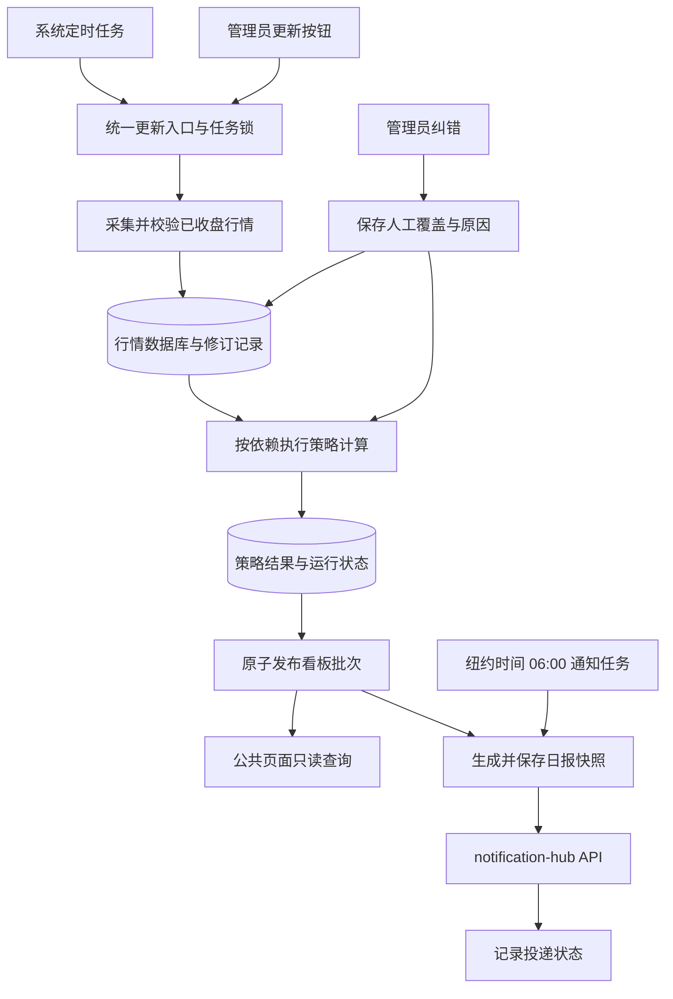

# Stock Tracker 日常使用优化实施计划

状态：待用户评审，尚未实施。日期：2026-10-21。

代码基线：`main` / `217d12466139798d3409966982f89a398d76dadb`。问题依据见[代码评审](../reviews/CODE_REVIEW_2026-10-21.md)。本文是后续 AI 分批实施的入口；本次只提交方案，不修改应用、数据库或部署。

## 1. 目标与范围

优先让现有股票观察系统可每天实际使用：数据库中的真实行情 → 可解释的策略结果 → 最新看板 → 纽约时间 06:00 日报 → notification-hub 推送。

保留 FastAPI、Jinja2、原生 JavaScript、Chart.js 和 SQLite；参考 Market Lab 的视觉风格，不迁入其研究变体、成员身份、owner token、任务 JSON 或前端框架。保留中英文。交易策略用于观察和研究，不增加自动交易、预测胜率和未经验证的仓位建议。

第一阶段包含：公共只读网站、单管理员、数据库主存储、统一行情更新、策略一致性、样式改造、日报和基础人工纠错。美债、实际利率、BEI 和扩展 ETF 看板是后续独立增量；此前目标保留，但不阻塞股票版上线，也不把现有 Market Pulse 冒充宏观实现。

### 已确定的设计与本方案建议默认值

| 项目 | 约定 |
|---|---|
| 行情更新入口 | 系统定时任务；管理员在股票数据页点击“更新数据”。两者调用同一 Python 工作入口 |
| 页面请求 | 只读数据库；不下载行情、不执行策略，包括 GET ticker 校验与详情页 |
| 新增股票 | 保存配置为待更新，明确提示下一次更新后可用；不隐式采集 |
| 通知 | 美国股票交易日纽约时间 06:00；内容和时间由本项目管理，渠道由 notification-hub 管理 |
| 建议采集时间 | 纽约时间 04:00，可配置；与 06:00 通知分开，预留失败恢复时间 |
| 时区 | 集中配置：市场 `America/New_York`，显示默认 `Asia/Shanghai` 可改；存储时间戳 UTC |
| 权限 | 访客看公开数据，单管理员维护；首版不做注册、成员角色或多租户 |
| 数据库 | 继续 SQLite WAL，统一为权威存储；CSV 是可选导入导出，完整备份使用数据库备份机制 |

## 2. 产品页面

| 页面 | 必须直接展示 | 管理员附加能力 |
|---|---|---|
| 概览 | 数据截至交易日、最近成功更新时间、成功/缺失数量；市场背景、Stage2 和收缩候选、退出变化；日报入口 | 最近任务状态与重试入口 |
| 观察池 | ticker、名称、实际价格日期、价格/涨跌、趋势与收缩状态、数据质量；搜索排序 | 新增/停用 ticker；“更新数据”及其进度 |
| 个股详情 | 数据库行情图、已保存指标、各策略完整条件、缺失原因、最近变化；行情与复权口径 | 对具体日期提交人工纠错或撤销覆盖 |
| 管理 | 非公开 | 登录、观察池维护、数据问题、更新记录、通知设置与投递状态 |

无信号展示“本日无候选”，不回填旧候选。行情存在而策略历史不足的股票仍显示价格，策略标注“历史不足”。任何旧结果必须显示真实日期和过期原因，不套用全局最新日期。Bottom Fisher 单列为逆势观察；Checklist 不显示为买入概率。

默认公开业务看板，不公开通知目标、凭据、管理员操作日志和私人备注。公开观察池范围需明确配置；未标记公开的私人条目不因建立公共路由而自动泄露。

### 视觉实施

参考 Market Lab 分支 `codex/release-c-main-readiness-review-20261020` 的固定提交 `c13f613a670301962003f75ee2da77ae550bd761`，仅借鉴已检查的样式体系：

- 画布 `#f3f1eb`，卡片 `#fcfbf7`，正文 `#192327`，次级文字 `#657176`，边框 `#d7d8d2`。
- 主色 `#173c50`，辅助蓝 `#25627b`，青色 `#26746d`；绿色/红色/琥珀色同时配文字，不能只靠颜色表达状态。
- 14px 卡片圆角、轻阴影，标题可用 Georgia，正文系统字体；数字等宽，表格优先，保留清晰密度。
- 修改 `web/static/css/style.css`、四个模板及 `main.js` 的图表/提示框颜色；清理硬编码深色和过多装饰 emoji。
- 在 360px 和 1440px 下检查导航、表格横向滚动、详情图、空态、失败态和中英文。语言上下文应为请求局部，修复全局 filter 覆盖。

## 3. 运行流程

纠错后调用计算入口，不调用采集入口，不构成第三种外部数据更新方式。定时任务和页面按钮都只提交一个持久化任务；同一任务被独立工作进程执行，关闭页面不取消它。SSE/轮询只查询状态，不承担执行生命周期。

采用同一应用镜像的轻量单工作进程和 SQLite 任务表即可，不引入 Redis、Celery 或独立工作流平台。锁需要数据库原子获取、租约/心跳、超时恢复，不能仅用内存变量或“先查再插”。

计算顺序依赖明确：行情和基准就绪 → Stage2 → 依赖它的收缩候选；Bottom Fisher 等按实际依赖执行；Checklist 使用同批次需要的结果；观察池宽度和 Market Pulse 在其依赖的股票结果之后聚合。迁移前从各函数确认依赖，不允许采集脚本顺便重算，然后编排再重算一次。

## 4. 数据库方案：在已有 SQLite 上完善

### 现状与职责

当前 `lib/db.py` 已有 `watchlist`、`stock_prices`、`strategy_results`、`strategy_states`、`signal_changes`、`market_pulse`、`pipeline_runs`、`notification_log` 和 `db_meta`。Docker Compose 已挂载持久化 data 卷。需要改进职责和约束，而非从 CSV 项目重新搭建数据库。

数据库负责观察池、资产依赖、行情、指标、策略结果、任务状态、发布批次、报告和纠错。`config/tickers.json` 降为首次初始化种子或显式导入文件，禁止日常更新时覆盖网页维护的数据。CSV 导入要校验和去重；导出从数据库读取完整指定范围。现有增量 CSV 不保证全历史，不能称作数据库备份。

### 最小必要的存储改造

| 对象 | 需要增加或调整的内容 |
|---|---|
| 资产/观察池 | 启用状态、公开范围、数据源 symbol、基准角色；统一被定时和手动入口读取 |
| 行情 | 交易日、数据源、采集时间、价格口径、质量状态、修订标识；禁止用 0 代替缺失 |
| 人工覆盖 | ticker、日期、字段、新值、原始值引用、理由、操作者、时间、撤销标志；保留来源原值 |
| 更新任务 | 独立 `run_id`、触发方式、目标交易日、开始/结束时间、心跳、阶段和逐资产结果 |
| 策略结果 | `run_id`、实际行情日、策略 ID、规则版本、数据修订引用、计算状态及条件明细 |
| 发布批次 | 指向确定的结果集合及数据引用；事务切换当前指针，避免页面读到半批更新 |
| 日报/投递 | 冻结报告内容与批次引用；目标渠道、幂等键、分段结果、重试与不确定状态 |

采用受版本控制的增量迁移，复用能满足要求的现有表；不预先建设通用血缘、任意研究变体或事件平台。历史行情修订的存储至少能重建已发布批次使用的输入：可采用追加修订记录和当前值视图，不仅记录一个无法还原的 hash。前台不要求用户选择版本。

既有价格口径无法证实时标记 `legacy_unknown`；选择重采或明确排除，不能伪造来源和采集时间。既有结果标记旧规则，不把旧数据升级成已经通过新校验的结果。新增唯一约束前检查重复、空值和历史状态。

### 迁移与运维

1. 核对 VPS 实际版本、数据库路径、挂载卷、CSV/JSON 数量和全部定时入口；不得假设线上与 main 一致。
2. 用 SQLite backup API 或等效一致性备份，保留原数据库与旧文件；不要直接复制写入中的主文件而忽略 WAL。
3. 在副本执行迁移，比较 ticker 数、逐 ticker 日期范围/行数、关键价格和历史报告；导入可重复执行。
4. 在小观察池演练完整任务和恢复；切换时暂停旧任务，确保只有一个调度者和发送者。
5. 提供版本对应的恢复步骤并验证备份可恢复；原始文件待验证后再归档，不在本轮自动删除。

单台 VPS、日线级数据、一个采集写入者与有限 Web 查询先使用 SQLite。遇到多实例写入、持续锁争用或明确的高可用需求后再评估 PostgreSQL；本轮通过合理索引、短事务和单写入编排解决已有问题。

## 5. 时间、数据源和更新规则

新增一个集中配置入口（例如 `config/settings.toml` 加 `lib/settings.py`），管理时区、交易所日历、调度时间、基准、数据源与默认窗口；凭据通过环境变量注入，不提交仓库。时间显示和调度都读取该入口，不在脚本各自写时区。

- 交易日是市场日期，不是 UTC 日期或脚本启动日期；`fetched_at`、`computed_at`、`published_at` 是 UTC 时间戳，页面同时展示明确时区。
- 盘前默认更新最近一个已完成美股交易日。手动更新同样过滤尚未结束的交易日；休市、半日市、夏令时和跨年需测试。
- 采用维护中的交易所日历库，实施时核对支持范围、许可证和边界；禁止以星期一到五替代交易日历。不要把代码中的硬编码 UTC cron 当作纽约时间。
- 建议 OS 定时器按固定频率调用无网络的到期检查器；它依据集中配置和任务幂等记录决定是否入队。通知时间在管理页修改后写入数据库设置，通过统一设置服务读取；无需修改 cron。调度器仍是系统任务，Web GET 不运行它。
- 更新集合 = 数据库启用股票 + 所需基准/指数；保留 `yf_ticker` 映射。新增股票按最大策略窗口及预热期回补，不能只取 365 个自然日并假设足够。
- 采集适配器只获取/规范化数据；计算只读已保存输入，不直接调用 yfinance。第一版继续使用现有行情源，但明确记录超时、限流、空结果和服务不可用；不得填入模拟数据冒充实盘。
- 明确原始成交价与策略使用的复权序列；一致记录 adjusted OHLCV 的具体口径和来源。自动复权请求失败不能静默退回非复权。页面价格标签与收益计算使用的口径必须一致或明确区分。
- 常规增量包含可配置回看窗口以修复近期修订；拆分、异常跳变、历史缺口触发回补标记，由上述同一更新入口执行。未确认历史一致性时阻止受影响策略通过。
- 单个 ticker 失败不掩盖其他成功，也不把旧价当新价。发布批次允许明确的部分成功；每项显示实际日期，依赖不足的策略标记不可计算。

命名保持业务稳定：策略 `stage2_us` 配独立 `rule_version=v1`，人可读可显示 `stage2_us_v1`；运行名如 `daily_us_20261021T080000Z_<短ID>`，目标交易日另列。时间戳用于运行/导出文件，不能每次更新就创建新策略名称。禁止 `release_c` 阶段名进入业务 ID。

## 6. 策略和发布一致性

1. 清除跨任务的行情缓存；单次计算上下文绑定确定的数据修订、目标日期与基准。
2. 修复 Stage2 缺基准仍通过、历史窗口不足、均线回看边界和日期对齐。必需条件缺失时为 `insufficient_data`，不是 `false`，也不能减少分母变成全通过。
3. 把计算状态与信号布尔分开：`ok`、`insufficient_data`、`stale`、`failed`；只有 `ok` 下才讨论匹配/未匹配。候选退出须基于成功计算；数据失败不能自动当退出。
4. VCP 当前规则先命名“收缩候选”，修复退出和无候选时的旧状态；连续活跃不能每天重置进入日期。收缩/量缩硬门槛、突破确认等业务规则变更另开规则版本与样本验收，未经用户接受不混入一致性修复。
5. Bottom 与 Checklist 保留原有可解释条件，明确完整周或暂态周。条件缺失、计算失败和不满足必须区分；不把分数翻译成胜率。
6. 各入口使用同一个策略服务，不维护 Web 和 CLI 两套保存字段；技术指标提前计算并入库。
7. 无新增价格但此前失败、规则升级或数据纠错时，应允许只重算；不把“新增行数为零”理解为“不需要计算”。重复执行不重复写入同一信号事件。
8. 结果计算完毕后事务发布。页面、API、导出、日报读取同一发布批次；总数、列表和条件明细一致。旧批次保留只读用于审计与报告链接。

## 7. 管理权限与人工纠错

使用单管理员登录，密码哈希、服务端验证、适当的登录限流；会话 cookie 配置 HttpOnly、部署 HTTPS 下的 Secure 与合理 SameSite；所有写请求做 CSRF 防护。鉴权覆盖 API、刷新、配置、纠错、重算和通知测试，不能只隐藏按钮。秘密值保留在服务端，UI 只显示配置是否有效。

管理员补录或纠错需选择 ticker、交易日、字段和值并填写原因；校验数值、日期、OHLC 关系和成交量。有效视图优先使用未撤销的人工覆盖，保留源数据；之后源更新不静默抹掉覆盖，可提示冲突待处理。撤销恢复来源值并重算受影响结果。

纠错对均线和滚动策略的影响不止修改当日，应计算受影响日期范围；历史重算产生新修订，不修改已发送报告正文，不默认补发历史通知。前台显示“人工修正”及日期，敏感操作日志仅管理员可见。

## 8. 日报与 notification-hub

Stock Tracker 负责发送时间、选定内容、接收配置引用、日报快照和任务记录；notification-hub 负责 Telegram 等渠道凭据、格式适配和投递。本项目不重新建立 bot 管理平台。实施前核对 hub 实际鉴权、请求格式、幂等和回执能力，编写契约测试，不凭空假定接口。

默认纽约时间 06:00 在美股交易日发一次，使用上一完成交易日的数据。内容包括数据截至日期、缺失/过期、市场背景、观察池变化、Stage2、收缩候选、逆势观察和看板链接。定时器只读取已生成快照，不临时下载或重算。

若 06:00 没有目标日报，生成并发送明确的延迟/缺失状态摘要，不把旧日报包装成当天；完整日报恢复后的补发设为单独可配置策略，默认关闭以免重复打扰。管理员可显式发送，并带对应日期与修订提示。

投递幂等键关联报告、计划和目标；超时结果未知时先查询/核对，不盲目重发。长报告分段要有独立状态。若 hub 不支持回执查询，需要实现明确的“不确定”状态和人工处理入口，不能声称 exactly-once。

切换期间保留旧直接 Telegram 实现作为回滚路径，但同一计划只启用一个发送后端；切换验证后禁用旧 cron 的直接推送。管理页测试发送需要明确按钮，不在保存配置时自动发消息。

## 9. 实施批次与预估

按一位熟悉 Python/Web 的开发者、可用现有数据源和 VPS、hub 契约可用估算。人日包括必要测试与联调，不等于 AI 生成耗时；线上历史数据质量和 API 差异会改变工作量。

| 批次 | 工作与主要文件 | 完成标准 | 估计 |
|---|---|---|---|
| S0 基线与管理边界 | 小型回归测试、配置入口、管理员会话与写 API 鉴权、迁移/备份框架；`web/app.py`、`api.py`、`lib/db.py` | 未登录不能执行写操作；旧数据副本能备份恢复；五项复现纳入待修复测试 | 1–2 人日 |
| S1 统一数据库和更新 | `lib/config.py`、`lib/pipeline.py`、采集/编排脚本、任务表和状态 API | DB 观察池为准；两入口同一路径；关闭页面不终止；基准和闭市日期正确 | 2–3 人日 |
| S2 策略与发布 | 四策略、技术指标、Pulse、结果迁移与发布批次 | 缺失不误报、旧状态退出、无重复计算；页面/API/报告同批次 | 2–3 人日 |
| S3 页面与样式 | 模板、CSS、JS、i18n、公开只读页面和管理导航 | 暖白样式、真实价格/日期、条件明细、空态、360px/1440px 可用 | 2–3 人日 |
| S4 日报闭环 | `lib/report.py`、`lib/notifier.py`、日报快照、hub 适配、调度设置 | 06:00 时区与日历正确；可验证投递，重复运行不重复推送 | 1–2 人日 |
| S5 人工纠错与发布 | 覆盖记录/管理表单、影响重算、部署文档、恢复演练 | 修正可撤销；历史报告不变；VPS 小规模验收通过 | 2–3 人日 |

核心股票闭环 S0–S4 约 8–13 人日；包含基础纠错和部署演练约 10–16 人日。数据重采规模大、hub 需要新增能力或正式 VCP 规则重设计时另行估算。不要以页面完成或代码行数作为交付标准。

## 10. 验收清单

| 编号 | 场景 | 必须满足 |
|---|---|---|
| A01 | 浏览概览、观察池、详情与 API | 零外部行情请求、零策略计算，读取数据库 |
| A02 | 未登录调用所有写接口 | 被拒绝；不能刷新、变更 ticker、修正或发通知 |
| A03 | 网页新增和停用 ticker 后执行定时任务 | 新增纳入、停用保持；JSON 不覆盖 DB |
| A04 | 同时点击刷新和触发定时器 | 同一工作范围仅一有效任务；返回可追踪 run_id |
| A05 | 关闭页面或工作进程中断 | 页面关闭任务继续；进程中断可识别并安全恢复，无永久 running |
| A06 | 交易所假日、半日市、夏令时切换与跨年 | 正确选取最近完成交易日；06:00 为纽约当地时间 |
| A07 | 行情源失败、SPY 缺失、历史不足、缺成交量 | 明确缺失；不变成 0、不缩小分母、不冒充成功 |
| A08 | 更新后再次计算同 ticker | 使用新数据修订，未命中上次任务旧缓存 |
| A09 | Stage2/VCP 候选减少至零 | 正常显示零；成功评估的旧活跃状态退出；失败不伪造退出 |
| A10 | 当天零信号但昨天有信号 | 页面不回填昨天结果；历史另有日期标识 |
| A11 | 一批部分失败、无新增行但需重算 | 正确区分状态；需要重算的策略能够恢复 |
| A12 | 未收盘行情、价格口径降级、公司行动 | 未收盘不发布；口径不静默切换；不一致历史被识别 |
| A13 | 一次更新与重复执行 | 不重复计算同一阶段、不重复生成进入/退出事件 |
| A14 | 同批次页面/API/日报对照 | 日期、价格、候选数、条件与状态一致 |
| A15 | 人工修改后源数据再次更新、再撤销修改 | 覆盖保留且有原因；撤销可恢复；滚动影响被重算 |
| A16 | 纠错后查看此前发送日报 | 内容不变、输入修订可追溯，不自动重发历史消息 |
| A17 | 通知超时、分段失败与重复调度 | 有明确状态和幂等处理；未知结果不冒充成功 |
| A18 | CSV 导出和数据库恢复 | 导出指定完整范围；一致性备份可还原 ticker/行情/结果 |
| A19 | 手机/桌面、中英文、缺失和失败态 | 可读可操作，不显示原始 token/任务 JSON，不依赖颜色理解状态 |

以小观察池包含 SPY、普通股票、新股/历史不足案例完成端到端验证，使用可控替身覆盖异常，再用实际行情做抽样对账。真实推送和 VPS 发布在实施阶段按用户授权执行；本方案提交不执行这些动作。

## 11. 后续 AI 实施规则

- 用户评审通过后逐批实施，每批提交代码、相关测试、迁移/回滚说明和验收证据。发现基线变化先核对 diff，不覆盖其他工作。
- 先固定数据与策略事实，再调整页面；允许样式独立推进，但不得用示例数据掩盖未打通的链路。
- 不重写全站、不扩展多租户权限、不为版本展示建设新平台。规则语义变化与正确性修复分开记录。
- 同步更新 README、DEPLOY、部署脚本及环境变量示例，标明唯一调度入口并下线重复任务。不要仅添加新脚本却保留旧 cron 同时运行。
- 每批报告哪些验收已完成、哪些受数据源或部署环境阻塞；不以“函数存在”“测试替身通过”宣称生产功能已完成。
- 后续宏观增量单独评审官方数据源、利率/收益率口径、发布时间及修订规则，复用数据库/调度/日报能力，避免再次建立与股票看板脱节的平台。
